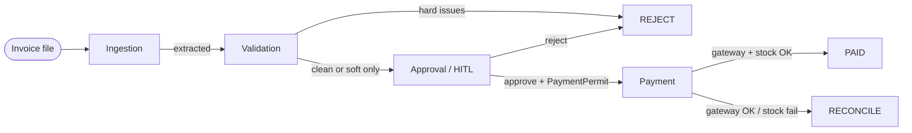

# 🧾 Galatiq Invoice Processing System

<p align="center">
  <strong>Multi-agent AP automation for the Galatiq case</strong><br/>
  Custom SQLite pipeline · Live Grok or offline stub · FastAPI Control Centre · HMAC PaymentPermit
</p>

<p align="center">
  <a href="https://github.com/Rinnegan27/galatiq-invoice-system/releases/tag/v2.0.0"></a>
  <a href="https://www.python.org/downloads/"></a>
  <a href="https://github.com/Rinnegan27/galatiq-invoice-system/actions"></a>
  <a href="https://docs.astral.sh/uv/"></a>
  <a href="https://github.com/galatiq-ai/galatiq-case-invoices"></a>
</p>

<p align="center">
  <a href="https://github.com/Rinnegan27/galatiq-invoice-system">GitHub</a> ·
  <a href="https://github.com/galatiq-ai/galatiq-case-invoices">Case brief</a> ·
  <a href="CHANGELOG.md">Changelog</a> ·
  <a href="https://github.com/Rinnegan27/galatiq-invoice-system/releases">Releases</a>
</p>

---

## 📑 Contents

1. [How to run](#-how-to-run)
2. [Evaluator demo](#-evaluator-demo-three-steps)
3. [Other commands](#-other-common-commands)
4. [Aether Helix quality gates](#-aether-helix-quality-gates)
5. [Grok API note](#-grok-api-note)
6. [Intentional non-goals](#-intentional-non-goals)
7. [What this system does](#-what-this-system-does)
8. [Case brief compliance](#-case-brief-compliance-detail)
9. [Control Centre](#-how-to-use-the-control-centre)
10. [Architecture & state flowchart](#️-architecture--state-flowchart)
11. [Scenario checks](#-scenario-checks)
12. [Project layout](#-project-layout)
13. [Tech used](#-tech-used)
14. [Evaluation criteria](#-evaluation-criteria)
15. [Requirements map](#-how-this-solution-meets-the-requirements)
16. [Changelog and releases](#-changelog-and-releases)

---

## 🚀 How to run

Do these steps in order.

### 1️⃣ First-time build (install + all checks)

Install [uv](https://docs.astral.sh/uv/) first.

Then run **one** command from the repo root:

```bash
cd galatiq-invoice-system
make
```

> 💡 `make` and `make build` do the same work.

| Step | What runs |
|:----:|-----------|
| 1 | Sync deps (`uv sync --extra dev`) |
| 2 | Lint with ruff (check + format check) |
| 3 | Run all offline tests |
| 4 | Run the case scenario proof (`docs/scenario_proof.*`) |

If any step fails, the build stops.

<details>
<summary>📦 Pip fallback (no lockfile)</summary>

```bash
python3 -m venv .venv && source .venv/bin/activate
pip install -e ".[dev]"
make quality
make scenario-proof
```

</details>

### 2️⃣ Set the environment

> ⚠️ Do not commit `.env`. Git ignores this file.

```bash
cp .env.example .env
```

| Variable | Guidance |
|----------|----------|
| `XAI_API_KEY` | Leave blank for offline work. Set `xai-<your-real-key>` for live Grok. |
| `GALATIQ_PERMIT_SECRET` | Leave blank or remove the line. First run creates a random HMAC secret. |
| `GALATIQ_PROFILE` | Default **prod** (strict price + PO). Use **case** for the Galatiq corpus / scenario matrix. |

### 3️⃣ Case CLI contract (required path)

The case brief requires this command:

```bash
python main.py --invoice_path=data/invoices/invoice1.txt
```

With `uv` and the offline stub (case corpus profile for evaluator demos):

```bash
uv run python main.py --invoice_path=data/invoices/invoice1.txt --llm=stub --profile=case
```

Stdout is one JSON document. Payment log lines go to stderr. Add `-v` for the full audit.

> 📎 `data/invoices/invoice1.txt` is an alias of **INV-1001**.

---

## 🎬 Evaluator demo (three steps)

Use these steps for a fast review.

### A. Live Grok

1. Set a real key in `.env`: `XAI_API_KEY=xai-...`
2. Run:

```bash
uv run python main.py --invoice_path=data/invoices/invoice1.txt
```

The default engine is Grok. If the key is missing or bad, the CLI asks for a key or offline stub.

### B. Offline happy path

```bash
uv run python main.py --invoice_path=data/invoices/invoice1.txt --llm=stub --profile=case
```

Expect status `paid` for INV-1001.

### C. Case Simulation Contract

```bash
uv run python main.py --sim=case --llm=stub
```

Sim forces the **case** profile. Expect all W1–W10 workflows to pass. JSON is on stdout; payment prints are on stderr.

### 🧪 Scenario proof artifact

The case README scenario table is checked in under `docs/`:

| Artifact | Purpose |
|----------|---------|
| [docs/scenario_proof.md](docs/scenario_proof.md) | Human table |
| [docs/scenario_proof.json](docs/scenario_proof.json) | Machine report |

```bash
make scenario-proof
```

---

## 🛠️ Other common commands

```bash
# All sample invoices (offline; case corpus discounts need --profile=case)
uv run python main.py --all --llm=stub --profile=case

# Prod hardening (default): strict catalog prices + PO coverage
uv run python main.py --invoice_path=data/invoices/invoice1.txt --llm=stub --profile=prod

# Offline UAT (docs/uat_test_cases.md)
uv run pytest tests/test_uat_scenarios.py -q

# Stateful inventory ledger (case core 1001–1016; STOCK_MULT scales seed)
STOCK_MULT=1 LEDGER_LLM=stub make ledger
# Live Grok at 15× seed: STOCK_MULT=15 make ledger-live

# AP Control Centre UI
uv run uvicorn web.app:app --reload --port 8000
# http://localhost:8000
# Case Lab: http://localhost:8000/sim
# Reconcile: http://localhost:8000/reconcile
```

High-value Grok approval is **deterministic by default in `prod`** (one temperature-0
call + `ApprovalAudit`). Set `GALATIQ_HV_DETERMINISTIC=0` to force the critique loop,
or `=1` to force deterministic under `case` profile.

Architecture notes (orchestration graph + OTel path): [docs/architecture.md](docs/architecture.md).

| Surface | URL |
|---------|-----|
| 🖥️ Control Centre | http://localhost:8000 |
| 🧫 Case Lab | http://localhost:8000/sim |
| 🔧 Reconcile | http://localhost:8000/reconcile |

---

## 🧬 Aether Helix quality gates

Default build (first time and every full check):

```bash
make
# same as:
make build
```

Faster re-check after deps are already installed:

```bash
make check
# same as:
make quality
```

Other targets:

```bash
make sync
make lint
make smoke
make report
make scenario-proof
```

| Gate | Command | Coverage |
|------|---------|----------|
| 🏗️ Build (default) | `make` / `make build` | Sync + lint + offline tests + scenario proof |
| ✅ Check | `make check` / `make quality` | Lint + offline tests (no sync) |
| 💨 Smoke | `make smoke` | Fast CLI + case-sim stub |
| ⬛ Black box | `make blackbox` | Case sim, corpus, e2e |
| ⬜ White box | `make whitebox` | Parsers, policy, hardening |
| 🧹 Lint | `make lint` | Ruff check + format |
| 🧪 Scenario proof | `make scenario-proof` | Case README invoice matrix |
| 📋 UAT offline | `make uat` | `docs/uat_test_cases.md` |
| 📒 Ledger | `make ledger` / `make ledger-live` | Sequential stock (``STOCK_MULT``) |

> **Aether Helix** is the in-repo quality persona. It is a project nickname for gates. It is not a product role.

---

## 🤖 Grok API note

The case README shows a sketch with `from xai import Grok`.

This project uses the OpenAI-compatible xAI HTTP API instead:

| Setting | Value |
|---------|-------|
| Base URL | `https://api.x.ai/v1` |
| Client | `openai.OpenAI` |
| Default model | `grok-3` (see `XAI_MODEL`) |

Code: `invoice_automation/adapters/llm_grok.py`.

Offline work uses `--llm=stub`. No live key is required for CI.

---

## 🔐 Auth (mock OIDC + signed sessions)

Pay and approve mutations need a **signed** session cookie (`galatiq_session`).

1. Open [http://localhost:8000/login](http://localhost:8000/login)
2. Pick a demo user (`analyst@acme.local` or `vp@acme.local`)
3. The mock IdP issues a token. The app stores an HMAC session cookie.

Unsigned legacy `galatiq_role` cookies are ignored. Actor strings on `PaymentPermit` come from the verified session subject.

This is a **local mock IdP**, not a live Okta tenant. Replace `invoice_automation/auth/oidc_mock.py` when you wire real OIDC.

## 🚫 Intentional non-goals

We do not plan these changes:

- ❌ Port to LangGraph, CrewAI, AutoGen, or LangChain. The case allows a **custom solution**. This repo uses a custom SQLite queue pipeline.
- ❌ Expand the deprecated Streamlit `ui/`. Product UI is FastAPI `web/` only.

## 🗺️ Production roadmap

Still open for a later commercial cut:

- Live OIDC / enterprise IdP (Okta, Auth0)
- Mandatory PO matching as a hard default (soft bands and optional `require_po` already ship)

---

## 💼 What this system does

Acme Corp loses about **$2M/year** on manual invoice work (**30% error rate**, **5-day cycle**).

```text
Capture → Exceptions → Approvals → Audit and payments
```

Product UI is the FastAPI **AP Control Centre** in `web/`. Streamlit `ui/` is deprecated and not in git.

### 🔐 GALATIQ_PERMIT_SECRET

This secret signs **PaymentPermit** tokens. The LLM cannot authorize pay alone.

| State | Behavior |
|-------|----------|
| Blank or missing | Create a random hex secret. Save it to `.env`. |
| Placeholder or too short | Reject. |
| Set to a strong value | Use it. |

### 🖥️ CLI vs Approvals desk

When an invoice needs VP scrutiny (amount ≥ $10k or soft escalations), an
**interactive CLI** prompts for human HITL — the same choices as the desk:

| Choice | Result |
|--------|--------|
| `[a] Approve` | Human approve + pay (`PaymentPermit` actor `human_cli`) |
| `[r] Reject` | Human reject; no pay |
| `[e] Escalate` | Automated VP agent (Grok/stub reflection) |

| Path | Result |
|------|--------|
| Clean invoice ≤ $10k, no soft issues | Auto-approve and pay |
| Scrutiny required + TTY | Prompt a / r / e (default) |
| Scrutiny + non-TTY / CI | Automated VP (`--auto-vp` or `GALATIQ_CLI_AUTO_VP=1`) |
| Validation hard issues | Reject |

Flags: `--human-approval` (force prompt) · `--auto-vp` (force agent only).

The FastAPI Control Centre remains the full Exceptions / Approvals desk.
Role switcher in the UI is **demo auth only**.

---

## 📋 Case brief compliance (detail)

Mapped 1:1 to [galatiq-case-invoices](https://github.com/galatiq-ai/galatiq-case-invoices):

| Brief requirement | Where |
|-------------------|-------|
| 4 stages: Ingestion → Validation → Approval → Payment | `StageName` + agents/workers |
| Inventory seed WidgetA/B, GadgetX, FakeItem | `case_brief.INVENTORY_SEED` |
| Scenario table (1001/1002/1003/1008/1009/1016) | `docs/scenario_proof.*` + `--sim=case` |
| `mock_payment(vendor, amount)` | `case_brief.mock_payment` |
| Grok via xAI API / `grok-3` | `.env.example` + `llm_grok.py` (OpenAI-compatible client) |
| CLI `python main.py --invoice_path=data/invoices/invoice1.txt` | `main.py` |
| Structured logs / results | JSONL events + CLI JSON |
| Offline / no external payment APIs | mock gateway + stub LLM |
| PDF/TXT/CSV/JSON(+XML) corpus | `data/invoices/` |

---

## 🖥️ How to use the Control Centre

1. Open **Capture**. Process samples or upload files.
2. Open **Exceptions**. Fix fields. Approve and pay, or escalate.
3. Switch **Working as** to **Approver**. Open **Approvals**.
4. Open **Audit** for the ledger.

Case Lab: [http://localhost:8000/sim](http://localhost:8000/sim) (not in product nav).

---

## 🏛️ Architecture & state flowchart

This project uses a custom multi-stage pipeline with an **explicit stage graph** (wavefront drain). It uses SQLite queues, a workbench, optional Grok, and a non-LLM PaymentPermit fence. It is not LangGraph.

Full diagram + OTel export path: [docs/architecture.md](docs/architecture.md).



| Path | Trigger | Stock DB |
|------|---------|----------|
| Auto-pay | Clean, amount &lt; $10k, no soft issues | Full line decrement |
| VP / HITL | Amount ≥ $10k **or** soft issue (`sku_typo_review`, alias, abbrev `W-A`, …) | Decrement only after permit + pay |
| Hard reject | `unknown_item` (e.g. `Widg3tA`), `zero_stock`, bad qty, … | **No** stock write |
| Revision | Same `invoice_id`, new content hash | Delta only (`prior_items` credit) |
| Format twin | Same content, other file type | **No** second draw |

CLI/sim **stdout** is one JSON document. Logs (including live httpx) go to **stderr**.

### 🛡️ Hardening notes

- Default profile is **prod** (strict catalog price + PO). Use `--profile=case` for the case corpus.
- Permit nonces live in SQLite `consumed_permits`.
- Blank `GALATIQ_PERMIT_SECRET` creates a random secret.
- The system verifies the permit before pay. It consumes the permit only after pay succeeds. Retries stay possible.
- One orchestration path runs through `Pipeline.drain`.
- Grok auth failures fail closed. Due dates from Grok are kept.
- CI uses `uv sync --frozen` plus ruff and offline pytest.

---

## ✅ Scenario checks

Seed (case brief): **WidgetA 15 · WidgetB 10 · GadgetX 5 · FakeItem 0**.

### Case README table (fresh inventory each file)

Live Grok + `--profile=case`. Harness: process each file alone against a reseeded DB.

| File | Expected | Typical issues / notes |
|------|----------|------------------------|
| `invoice_1001.txt` | `paid` | Clean STP; A−10 B−5 |
| `invoice_1002.txt` | `rejected` | `insufficient_stock:GadgetX` @ 1× seed |
| `invoice_1003.txt` | `rejected` | `zero_stock:FakeItem` |
| `invoice_1004.json` | `paid` | A−3 B−2 |
| `invoice_1006.csv` | `paid` | A−5 B−3 |
| `invoice_1008.txt` | `rejected` | `unknown_item` SuperGizmo / MegaSprocket |
| `invoice_1009.json` | `rejected` | invalid qty / negative amount / missing vendor |
| `invoice_1016.json` | `rejected` | `unknown_item:WidgetC` |

Offline proof: `make scenario-proof` → `docs/scenario_proof.*`. Sim: `uv run python main.py --sim=case --llm=stub`.

### Stateful ledger (shared DB, original 1× seed)

```bash
STOCK_MULT=1 make ledger-live   # or: LEDGER_LLM=stub make ledger
```

| Checkpoint | DB after |
|------------|----------|
| T₀ seed | A15 B10 X5 F0 |
| After 1001 paid | A5 B5 X5 F0 |
| After 1002 reject | unchanged (overstock) |
| After 1004 + revised | A2 B3 X0 (revision draws GadgetX−5 only) |
| Terminal (20 files) | A2 B3 X0 F0 — never negative |

Full matrix: [docs/stateful_ledger.md](docs/stateful_ledger.md). At **15×** seed the same sequence stays non-negative with more pays (`make ledger-live` default).

### Name / VP path checks (UAT)

| Case | Input | Path | Outcome |
|------|-------|------|---------|
| TC-NAME-02 | `Widg3tA` | **Hard reject** (not VP) | `unknown_item` |
| TC-NAME-06 | `W-A` | **VP soft escalate** | `sku_typo_review:W-A→WidgetA` → pay after VP |
| TC-NAME-08 | `Widget Alpha` | **VP soft escalate** | typo review → pay after VP |
| High value ≥ $10k | clean HV body | **VP / HITL** | pay only with permit |

```bash
make uat                                          # offline stub
uv run python scripts/run_uat_live_grok.py        # live Grok
uv run python scripts/run_cli_vp_live_check.py    # CLI VP matrix
```

Operator walkthrough: [docs/user_journey.md](docs/user_journey.md). Full UAT catalog: [docs/uat_test_cases.md](docs/uat_test_cases.md).

---

## 📁 Project layout

```text
main.py                     # Case CLI
invoice_automation/         # Domain, agents, saga, workbench, sim
web/                        # FastAPI Control Centre
data/invoices/              # 100-file corpus
docs/                       # Scenario proof, architecture, evaluator artifacts
tests/                      # smoke / black_box / white_box
uv.lock                     # Locked deps
Makefile                    # default: make / make build (sync + all checks)
CHANGELOG.md                # Release history
CLAUDE.md                   # Coding rules
```

---

## 🧰 Tech used

| Layer | Tech |
|-------|------|
| 🐍 Language | Python 3.11+ |
| 📦 Package / lock | `uv`, `pyproject.toml`, `uv.lock` |
| 🧩 Domain models | Pydantic v2 |
| 🔄 Orchestration | Custom SQLite stage queues (not LangGraph) |
| 🗄️ Inventory / state | SQLite |
| 🤖 LLM (live) | xAI Grok via OpenAI-compatible API (`openai`, `https://api.x.ai/v1`) |
| 📴 LLM (offline) | Deterministic stub parsers |
| 📄 PDF text | pdfplumber |
| 🌐 HTTP | httpx |
| 🖥️ Product UI | FastAPI, uvicorn, Jinja2, python-multipart |
| 📊 Data helpers | pandas |
| ⚙️ Config | python-dotenv |
| ✅ Quality | pytest, ruff, Makefile, GitHub Actions |
| 🔐 Payment fence | HMAC `PaymentPermit` (stdlib `hmac` / `hashlib`) |
| 🔑 Workbench auth | Mock OIDC IdP + HMAC signed session cookie |
| 📦 Master data | SQLite stock + unit-price catalog + PO seed; stock decrement on pay |
| 📡 Spans | OTel-shaped JSONL (`spans.jsonl`) + optional `opentelemetry-api` |
| ✍️ Docs style | ASD-STE for README, comments, and operator text; NumPy docstrings for public APIs |

See [CHANGELOG.md](CHANGELOG.md) for version history. GitHub Releases hold the same notes.

---

## 🏆 Evaluation criteria

| Criterion | Evidence |
|-----------|----------|
| Functionality | Case sim; CLI + workbench; `docs/scenario_proof.*` |
| Code quality | Protocols, ruff, Aether Helix gates |
| Agentic sophistication | Multi-stage agents, optional Grok, self-correction |
| Shipping mindset | Offline-first; Control Centre UI |
| Above and beyond | Workbench, Case Lab, PaymentPermit, 100-file corpus |

---

## ✅ How this solution meets the requirements

This build covers the full Galatiq case surface.

| Requirement | How we deliver it |
|-------------|-------------------|
| Four stages: Ingestion → Validation → Approval → Payment | Durable SQLite stage queues + workers in `invoice_automation/agents/` |
| Inventory seed (WidgetA/B, GadgetX, FakeItem) | `case_brief.INVENTORY_SEED` reseeds on pipeline start |
| Scenario table (1001, 1002, 1003, 1008, 1009, 1016, …) | `docs/scenario_proof.*` + `--sim=case` (W1–W10) + 100-file corpus |
| `mock_payment(vendor, amount)` | Case-brief mock → `MockPaymentGateway` + payment saga |
| Grok / offline LLM | Default CLI = Grok; `--llm=stub` for CI |
| CLI contract path | `python main.py --invoice_path=data/invoices/invoice1.txt` |
| Structured audit trail | JSONL events, outbox publish, metrics snapshot |
| Offline / no live payment rails | Stub LLM + mock gateway |
| Multi-format corpus | txt / json / csv / xml / pdf under `data/invoices/` |
| High-value scrutiny | Stub/Grok reflection over $10k; Control Centre Approvals desk |
| Human-in-the-loop | CLI a/r/e gate + Exceptions/Approvals in FastAPI `web/` |
| Payment cannot be LLM-authorized | HMAC `PaymentPermit`; nonce consumed only after successful pay |
| Fail-closed extraction | Missing totals and bad keys do not silently succeed |
| Reproducible tooling | `uv.lock`, Makefile, ruff, smoke / black_box / white_box markers |
| Business invoice ids in CLI/results | Prefer extracted `INV-…` ids over file stems |
| Soft master-data price bands | Seeded unit-price bands; absurd prices flag `price_mismatch` |
| Local OTLP span batch | `spans.jsonl` and `otlp_traces.json` (no live collector) |
| Pay/stock reconcile hold | Gateway success and stock fail → `RECONCILE` / `PaymentStockReconcile` |
| Tax / fee tolerant totals | Totals above priced lines allowed; shortfalls flag mismatch |

---

## 📦 Changelog and releases

| Resource | Link |
|----------|------|
| 📝 Changelog | [CHANGELOG.md](CHANGELOG.md) |
| 🏷️ Releases | https://github.com/Rinnegan27/galatiq-invoice-system/releases |

Current package version: **2.0.0** (`pyproject.toml` and `invoice_automation.__version__`).

---

<p align="center">
  <sub>Coding rules → <a href="CLAUDE.md">CLAUDE.md</a> · Built for the <a href="https://github.com/galatiq-ai/galatiq-case-invoices">Galatiq case</a></sub>
</p>
