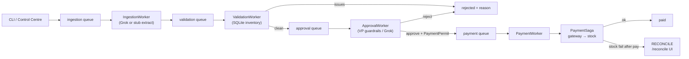

# Architecture

Short operator notes for the Galatiq invoice pipeline.

## Orchestration graph

Custom SQLite work-queue orchestration (not LangGraph). One drain loop claims at most one message per stage per step.



Stage workers: `invoice_automation/agents/workers.py`.
Drain: `Pipeline.drain` in `invoice_automation/orchestration/pipeline.py`.

## Master-data profiles

| Profile | Env | Price | PO | Soft bands |
|---------|-----|-------|----|------------|
| **prod** (default) | `GALATIQ_PROFILE=prod` | strict catalog (±5%) | required | off |
| **case** | `GALATIQ_PROFILE=case` | soft bands only | off | on |

Case simulation, scenario-proof, and pytest set `case` so the Galatiq corpus matrix stays green.
CLI default is **prod** unless `--profile=case` or the env is set.

## OpenTelemetry export path

1. Each drain stage writes a span via `SpanExporter` (`invoice_automation/telemetry/spans.py`).
2. Local files (under the run `work_dir`):
   - `spans.jsonl` — one JSON object per line
   - `otlp_traces.json` — OTLP/JSON `resourceSpans` batch
3. Optional live push: set `GALATIQ_OTLP_HTTP_ENDPOINT` to an OTLP/HTTP JSON collector URL (for example `http://localhost:4318/v1/traces`). Export is best-effort and never fails the pipeline.
4. Optional console: `GALATIQ_SPAN_CONSOLE=1` prints span lines on **stderr**.

Example collector smoke:

```bash
# Terminal A: any OTLP/HTTP receiver that accepts application/json
# Terminal B:
export GALATIQ_OTLP_HTTP_ENDPOINT=http://127.0.0.1:4318/v1/traces
uv run python main.py --invoice_path=data/invoices/invoice1.txt --llm=stub --profile=case
# Inspect:
#   .galatiq_runtime/spans.jsonl
#   .galatiq_runtime/otlp_traces.json
```

## Reconcile desk

When the gateway succeeds and stock decrement fails, the saga stores `RECONCILE` and emits `PaymentStockReconcile`. Operators use Control Centre **Reconcile** (`/reconcile`) to:

* **Retry stock** — after inventory is corrected
* **Ack** — close without a stock draw (investigated offline)
